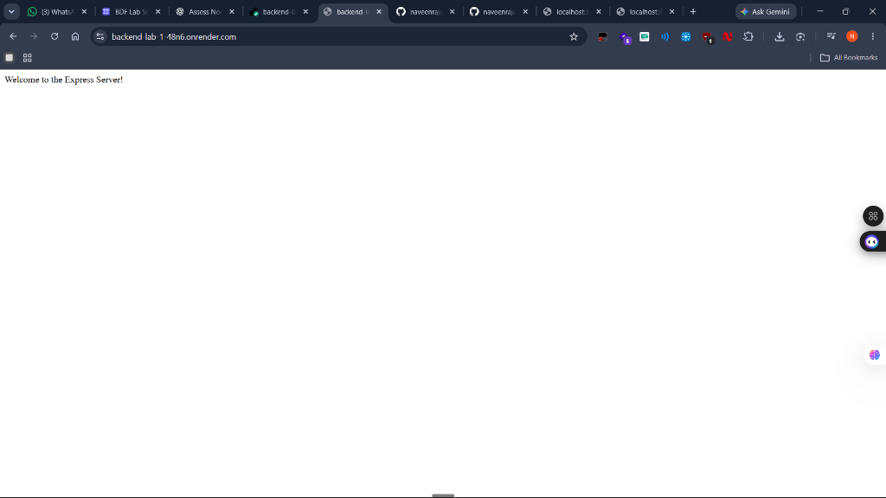
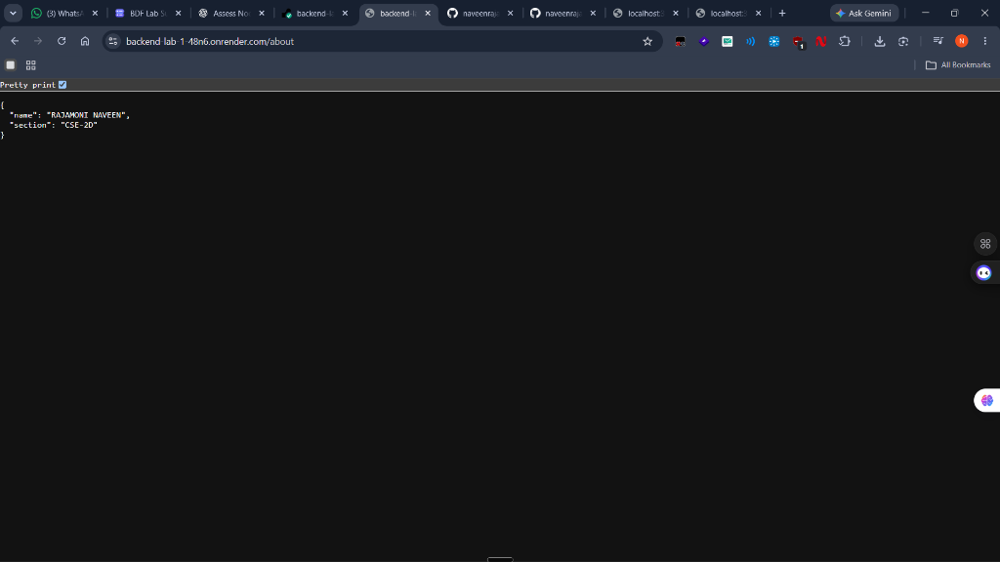
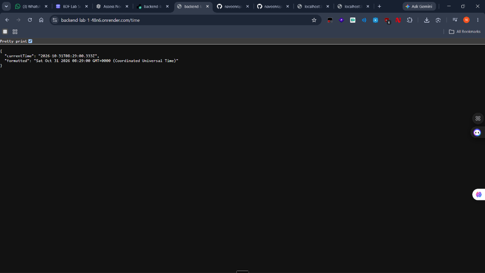
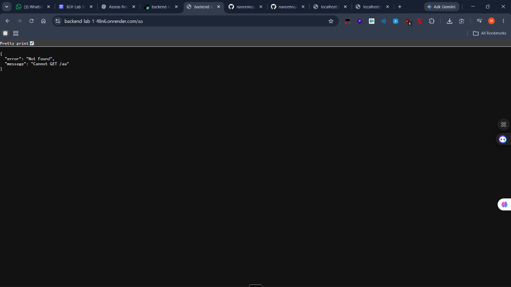

# Lab 01: Node.js and Express Server

**Student Name:** Rajamoni Naveen  
**Section:** CSE-2D

## Live Deployment

**Live URL:** [https://backend-lab-1-48n6.onrender.com/](https://backend-lab-1-48n6.onrender.com/)

## Project Description

This project demonstrates the fundamentals of backend development using Node.js and Express.js. It includes a basic HTTP server and an Express server with multiple GET endpoints.

## Technologies Used

- Node.js
- Express.js
- JavaScript
- npm

## Installation

```bash
npm install
```

## Running the Project

Run the Express server:

```bash
npm start
```

Run the native Node.js HTTP server separately:

```bash
npm run basic
```

## API Endpoints

| Method | Endpoint | Description |
|---|---|---|
| GET | / | Welcome message |
| GET | /about | Student information |
| GET | /time | Current date and time |
| GET | /unknown | 404 error demonstration |

## Screenshots

### Home Endpoint


### About Endpoint


### Time Endpoint


### 404 Endpoint


## Learning Outcomes

- Understood Node.js HTTP server creation.
- Learned Express application setup.
- Implemented GET routes.
- Understood HTTP status codes.
- Learned basic deployment using Render.

## Problems Faced and Solutions

1. **Port Binding on Cloud Hosting (Render)**
   - *Problem:* Hardcoding the listening port to `3000` causes deployment timeouts and health check failures on cloud hosts because the host assigns a dynamic port.
   - *Solution:* Used `const PORT = process.env.PORT || 3000;` so the server binds to Render's assigned port in production while defaulting to `3000` during local development.

2. **404 Catch-All Route Precedence in Express**
   - *Problem:* Placing the 404 catch-all middleware before the endpoint declarations caused every valid request to return a `404 Not Found` response.
   - *Solution:* Registered the 404 handler (`app.use(...)`) at the very end of the middleware stack, after all defined `app.get(...)` routes.

3. **Content-Type Formatting for API Responses**
   - *Problem:* Standard text responses may default to `text/html` instead of structured `application/json`.
   - *Solution:* Used `res.status(200).json(...)` for endpoints returning structured data (`/about` and `/time`) to explicitly send valid JSON and headers.
